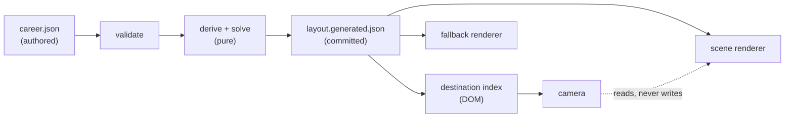
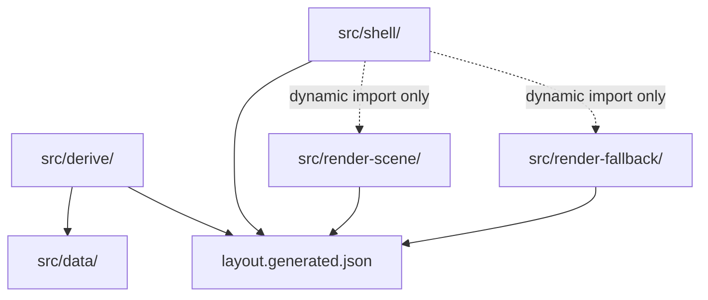
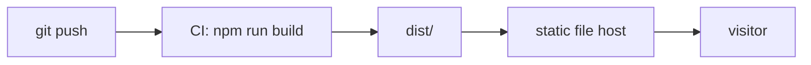

# Architecture Spine — Cosmos Portfolio

## Design Paradigm

**A build-time derivation pipeline feeding two read-only renderers.**

All data-to-visual reasoning happens once, at build time, in a pure pipeline: authored JSON → validated → derived → solved → committed artifact. At runtime nothing derives from career data and nothing solves; two independent renderers read the finished artifact and draw it. Realism's light direction and spin are composition read off positions and time, not data (AD-20).

The paradigm converts the product's three hardest constraints into structural properties rather than ongoing discipline: First Paint (NFR-1) is fast because the browser receives geometry rather than a physics problem; the opening frame (FR-24) is reproducible because the layout is committed rather than re-derived per load; and the two renderers cannot disagree (FR-22 content parity) because neither one interprets the source data.

Dataflow is unidirectional and acyclic at every layer.



| Paradigm stage | Namespace |
| --- | --- |
| Source of truth | `src/data/` |
| Pipeline (validate, derive, solve) | `src/derive/` |
| Renderers | `src/render-scene/`, `src/render-fallback/` |
| M3 realism layer, scene only | `src/render-scene/realism/` |
| Entry, routing, state, index | `src/shell/` |

## Invariants & Rules

### AD-1 — Force settling runs at build time [ADOPTED]

- **Binds:** FR-2, NFR-1, FR-21, FR-24, NFR-5
- **Prevents:** A solver gating First Paint; an opening frame that differs on every load, making FR-24's composed frame and its matching link preview impossible; a Colophon that can only describe the layout rule rather than exhibit its output.
- **Rule:** The force simulation runs during the build and writes settled positions into a committed layout artifact. The runtime scene never solves. Re-solving is a deliberate, explicit act: `solve` is a **separate npm script that `build` never invokes**, and `build` fails if the committed artifact is missing or fails AD-14's schema. "Deliberate" is thereby a property of the scripts, not of the author's memory.

### AD-2 — The solve is deterministic

- **Binds:** FR-2, FR-24, AD-1
- **Prevents:** A committed artifact that churns on every build, producing meaningless diffs and silently breaking FR-24's reproducible opening frame.
- **Rule:** Identical input JSON must produce byte-identical layout output. Seed all randomness explicitly (`randomSource`), fix the iteration count rather than settling on an energy threshold, and never rely on object-key or float-accumulation ordering. A determinism regression test — solve twice, assert byte-identical — is part of the test suite, and **each solve must construct a fresh generator**: d3's default LCG is module-level state with a hardcoded seed that does not reset between runs, so a test reusing it would pass while proving nothing.

### AD-3 — Single derivation point

- **Binds:** FR-3, FR-5, FR-9, FR-18, FR-22, all renderers
- **Prevents:** The scene and the Fallback each interpreting the source data and disagreeing. Classification by absence (FR-5) makes this acute: `notable != null` and `notable !== ""` differ on an empty string, so one renderer would show a Deep Project and the other a Shallow one — unnoticed, because nobody views both surfaces at once.
- **Rule:** Every data-to-visual derivation — `isDeep`, mass, luminance band, dwell tempo, mote tier, shot framing — is computed once in `src/derive/` and resolved in the emitted artifact. No renderer contains a classification test, a mapping-rule computation, or any conditional on a raw content field. **No module outside `src/derive/` may import from `src/data/`** — not the renderers, not `shell/`, not `tokens/`, and not `colophon/` (which receives the raw file as emitted data, per AD-17, rather than importing it). There is exactly one read path to the source of truth.

### AD-4 — The DOM index is the source of truth for destinations

- **Binds:** FR-19, FR-22, EXPERIENCE.md §11, §11.1 P1–P4
- **Prevents:** Focusable elements sliding under the user during continuous camera motion, and off-screen Bodies having no valid focus position — the failure that makes "the camera is presentational, the index is the interface" aspirational rather than true.
- **Rule:** A persistent DOM navigation lists every destination, generated from the layout artifact. It never reads render state, never re-projects, never moves with the camera. The canvas is `aria-hidden`. Focus lives in the DOM; **the camera reacts to DOM focus, never the reverse.** Enforceably: no module outside `render-scene/` may import camera state, and no state field is written by the camera. Pointer raycasting (AD-15) is the one accepted read of scene geometry, and it resolves to an emitted destination ID rather than to a camera-dependent position. *[amended 2026-10-15 by ruling Q2 (story 4.1): the DOM index renders from the mount chunk, the one dynamic import after the thin entry, and still before any renderer chunk is requested; it is no longer on the entry chunk itself.]*

### AD-4a — The Rail is Client-granular; Projects are never Rail stops [ADOPTED]

- **Binds:** FR-16, FR-17, FR-17a, FR-18, AD-9, `derive/shots.ts`, `derive/dwell.ts`
- **Prevents:** The single largest divergence available to anyone building from this spine — encoding a Project-granular journey. The PRD's UJ-2 describes the camera bringing a visitor *to a Deep Project* and dwelling there; EXPERIENCE.md §9.2 ratifies that this is **no longer how it works** and marks it "STRUCTURAL DEVIATION FROM THE PRD — read this before building." A unit built from the PRD alone will produce ~15–16 Rail stops, per-Project Dwell, and a per-Project default Shot; a unit built from the UX will produce ~5–6. The two are incompatible at the camera, the index order, and the pacing model simultaneously, and neither surfaces until the camera exists.
- **Rule:** The Rail has one stop per **Client** (~5–6), never per Project. A Client stop frames that Client's entire system so every one of its Projects is on screen and selectable at once. **Dwell derives at Client granularity** (from the count of Deep Projects in that system), never per Project. The **default Shot template operates on Clients** and must frame the Client's full system including its widest-orbit Project — this is how FR-17a's "adding a Project produces a journey that visits it" is satisfied, by framing rather than by a new Shot. ~~`railPosition` in AD-9 indexes Clients.~~ *[superseded 2026-10-14 by ruling R1 (story 3.19): the field is dropped, with `selectClient`; `scrollProgress` alone says where the Rail is, and an integer `k` is the `k`-th Client stop. The rule that the Rail's stops are Clients stands.]* Projects are reached only by deliberate selection (AD-9 Focus), never by the Rail arriving at one.

### AD-5 — Destinations are addressed by stable entity ID

- **Binds:** AD-4, FR-17, FR-19
- **Prevents:** The two input paths — DOM focus and pointer raycast — resolving to different things; and Shot definitions decaying into position references, which FR-17 explicitly prohibits.
- **Rule:** Every destination reference — index entry, Shot subject, raycast hit, focus target, URL fragment — names an entity ID. Never a screen position, a render-order index, or an array offset.

### AD-6 — Routing decides before the 3D bundle is fetched

- **Binds:** FR-22, NFR-1, UJ-3
- **Prevents:** Shipping ~1MB of React, R3F, and Three to a mobile visitor who will only ever see a flat star chart — technically satisfying FR-22 while wrecking the Fallback's performance on precisely the devices UJ-3 depends on.
- **Rule:** Capability detection runs in the entry module as plain JavaScript, before any dynamic import resolves. Detection is **not** a React component and must not transitively load the scene. The entry chooses one chunk and loads only that.

### AD-7 — Three lazy chunks, one thin entry

- **Binds:** AD-1, AD-6, NFR-1, FR-21
- **Prevents:** The solver landing in the First Paint bundle and defeating AD-1; the scene loading for Fallback visitors; the Colophon's demonstration cost being paid by every visitor.
- **Rule:** `src/shell/entry` contains no React and no Three. **Four** chunks load dynamically and independently: `render-scene`, `render-fallback`, `colophon` (AD-17), and `solver` (the Colophon's live re-run only). **Nothing on the critical entry path may statically import the scene, the solver, or the raw career JSON.** This is a property of *bundler output*, not of source intent — a stray re-export can hoist a chunk into the entry silently. The build therefore asserts it: a CI check fails if the entry chunk exceeds its size budget or if its module graph reaches Three, the solver, or `src/data/`. *[amended 2026-11-01 for M3: `realism` is a fifth lazy chunk, requested only by the running scene (AD-22), never by the entry or the mount chunk.]*

### AD-8 — Capability routes; performance offers

- **Binds:** FR-22, NFR-2a, NFR-3
- **Prevents:** An irreversible guess about a machine made before evidence exists, and a performance probe spending the one budget NFR-1 protects.
- **Rule:** `detect()` tests WebGL2 context creation only — no performance probe in the First Paint path. Mobile always routes to the Fallback, where **mobile means a coarse primary pointer, never viewport width**: EXPERIENCE.md §10 ratifies that window size is not a capability signal, so a narrow desktop window keeps the scene with a narrower panel. If the running scene then fails the NFR-2a floor, the Fallback is **offered** through the existing persistent one-click affordance, never forced. Reduced-motion is an independent axis: a `prefers-reduced-motion` visitor on a capable machine keeps the scene with adapted motion, and is never rerouted.

### AD-9 — One state machine owns navigation

- **Binds:** FR-12a, FR-16, FR-19, EXPERIENCE.md §5.1, §7.1, §7.1a
- **Prevents:** The camera and the DOM index disagreeing about what is focused; scroll's two meanings being resolved differently in two places; Escape releasing two layers at once.
- **Rule:** A single store holds ~~`{ mode: rail | freeflight, focusedProjectId: ProjectId | null, railPosition: ClientId }` — `railPosition` indexes **Clients**, per AD-4a~~ *[superseded 2026-10-14 by ruling R1 (story 3.19): `railPosition` and `selectClient` are dropped. `scrollProgress` already says where the Rail is — an integer `k` is the `k`-th Client stop — and a discrete twin with no writer invites the two-writer fight AD-16 forbids. Free flight keeps `scrollProgress`, so the Rail is re-entered where it was left.]*. Camera and index are both subscribers; neither owns state nor mutates it directly. All transitions are named events. Focus is exclusive — at most one `focusedProjectId`. Escape releases exactly one layer, innermost first, per EXPERIENCE.md §7.1a.

### AD-10 — Scroll meaning is resolved by mode alone

- **Binds:** FR-12a, AD-9, UJ-2
- **Prevents:** The bug that makes UJ-2 unbuildable — reading 150 words of prose moving the camera off the thing being read.
- **Rule:** Scroll's two meanings are selected **solely** by reading the state machine's mode, never by event-target inspection or DOM hit testing. While `focusedProjectId` is non-null, scroll belongs to the panel and the camera subscribes to nothing.

### AD-11 — Schema validation is a hard build gate

- **Binds:** FR-5, FR-7, UJ-4, NFR-5
- **Prevents:** The most dangerous failure this data model invites: because entities are typed by field *absence*, a misspelled field name silently changes an entity's type rather than raising an error. `notabel` instead of `notable` turns a Deep Project Shallow, with no error anywhere and no symptom until a reader fails to find the entry worth reading.
- **Rule:** `career.json` is validated against an explicit schema before derivation, and the build **fails** on violation. Validation must **reject unknown fields**, not merely check known ones. This is what makes UJ-4's "add an entry in five years" actually safe.

### AD-12 — Design tokens are generated from one source

- **Binds:** FR-20, DESIGN.md
- **Prevents:** The scene and the DOM surfaces drifting apart on colour, type, and stroke — invisible in code review, glaring on screen.
- **Rule:** DESIGN.md's frontmatter is the token source of truth. It is transformed once into CSS custom properties (DOM surfaces) and a typed JS object (scene materials). Both are generated from that single source; **neither is hand-transcribed**, and no colour or type value is written literally in a component. *[amended 2026-11-01 for M3: the pixels of a texture map (AD-21) are the one colour source outside the tokens. Star glow and the ambient floor are tokens in a `realism-*` family, declared in DESIGN.md's frontmatter by the first M3 story; the achromatic audit exempts that one prefix by name and nothing else. Hue is confined to the realism layer; line-work, Dust and every DOM surface stay achromatic.]*

### AD-13 — Two files, one authored

- **Binds:** FR-1, FR-21, NFR-5, UJ-4
- **Prevents:** A future maintainer editing the generated artifact, and the Colophon exhibiting an input file while claiming to exhibit a model.
- **Rule:** `career.json` is authored and is the sole source of truth. `layout.generated.json` is emitted, committed, and never hand-edited — it carries a generated-file banner. The Colophon renders **both, with the mapping rules between them**, so the transformation itself is what a visitor inspects.

### AD-14 — The layout artifact has a declared, versioned schema

- **Binds:** AD-1, AD-3, AD-13, both renderers, `colophon/`, `shell/`
- **Prevents:** The highest-leverage divergence in the system. `layout.generated.json` is the contract every consumer reads, and an undeclared contract is no contract: a scene unit would reasonably emit a flat Body array carrying 3D positions, while a Fallback unit — whose ratified projection is **time-as-axis**, not a projection of the solve — would reasonably emit a Client-nested tree carrying a time scalar. Both obey every other AD and consume two different documents that happen to share a filename.
- **Rule:** The artifact's shape is declared as an explicit, versioned schema in `src/derive/`, and the build fails if the emitted artifact does not validate against it. It carries **every surface's needs in one document**: entity IDs and kinds; solved 3D positions (scene); the time-axis scalar (Fallback); all derived visual properties (`isDeep`, mass, `luminanceBand`, mote tier); Dwell tempo at Client granularity; Shot framing; and the full content payload every surface renders, since FR-22 makes content parity absolute. A consumer needing a value the schema lacks is a change to the schema and the derivation, never a local computation.

### AD-15 — One emitted destination set

- **Binds:** AD-4, AD-5, FR-19, EXPERIENCE.md §11
- **Prevents:** Two owners of the destination set. AD-4 (DOM index) and AD-5 (raycast) both address by entity ID and can still diverge: a Moon or a Client Star may raycast to an entity the index has no entry for, and an off-screen Body exists in one path but not the other — the exact failure AD-4's *Prevents* clause names, reintroduced through the back door.
- **Rule:** The derivation emits **one `destinations` list**; the DOM index and the raycast target set are both built from it and from nothing else. Their cardinality is asserted equal at the build gate. An entity that is not in `destinations` is not reachable by any input path, and one that is must be reachable by all of them.

### AD-16 — One writer per state field

- **Binds:** AD-9, AD-4a, EXPERIENCE.md §5.1, §7.1a
- **Prevents:** Two units writing the same field by different mechanisms. A Rail unit would drive `railPosition` continuously from damped scroll; a keyboard-index unit would set it discretely on activation — leaving `aria-current` disagreeing with the camera about where the visitor is. *[superseded 2026-10-14 by ruling R1 (story 3.19): the field named here is dropped; scroll progress is the one record of where the Rail is, so there is no discrete field left for a second writer to contest.]* Separately, EXPERIENCE.md §7.1a's Escape table must know *where Focus was entered from*, which a three-field store cannot represent.
- **Rule:** Every state field has exactly one writer. The store carries `focusOrigin` (`rail | freeflight`) explicitly, stored at Focus entry rather than inferred at release, so Escape returns to the layer it came from. ~~Continuous scroll progress and the discrete current Client are **separate fields**: the camera reads progress, the index reads the discrete Client, and neither writes the other's.~~ *[superseded 2026-10-14 by ruling R1 (story 3.19): there is no discrete current-Client field; the camera reads scroll progress and writes nothing.]*

### AD-17 — The Colophon is a fourth chunk and re-solves in isolation

- **Binds:** AD-2, AD-7, AD-13, FR-21
- **Prevents:** Two failures at once. First, a literal reading of AD-7's three-chunk list leaves `colophon/` unaccounted for while FR-21 requires it to render raw `career.json` — which would put the raw file in the entry bundle and defeat AD-7. Second, AD-2's determinism is a *same-environment* guarantee: a live browser re-solve may legitimately settle differently from the committed Node solve, so the one surface built to prove the site cannot rot would be caught demonstrating it rotting.
- **Rule:** `colophon/` is a **fourth lazy chunk**, loaded on navigation and never on the critical path. Both files it exhibits reach it as **emitted data** — the raw JSON is copied into the build output as an asset, never statically imported. Its live re-solve is presented as a **demonstration of the mechanism, not a reproduction of the shipped layout**, and the page says so; the committed artifact remains the only layout any renderer reads.

### AD-18 — Three addressable surfaces, one router

- **Binds:** FR-21, FR-22, AD-6, AD-7, EXPERIENCE.md §4.7
- **Prevents:** Three independently reachable surfaces (scene, Fallback, Colophon) with no owner for how a visitor moves between them or what the browser Back button does. EXPERIENCE.md §4.7 specifies a return contract — the scene resumes at the stop it was left at, not at First Paint — which is unbuildable if navigation is unowned.
- **Rule:** The three surfaces are the only addressable routes, resolved in `shell/` by AD-6's entry before any chunk loads. Route changes are real history entries, so Back works. Surface-level position (which Client stop the scene was left at) is preserved on departure and restored on return; **Focus is not a route** and does not create a history entry — it is scene state, released by Escape per AD-9, never by Back.

### AD-19 — Realism draws beneath the line-work, with no full-screen pass [ADOPTED]

- **Binds:** NFR-2, NFR-3, NFR-7, FR-15, FR-20, DESIGN.md "The M3 attachment surface", `scene.tsx`, `body-field.tsx`
- **Prevents:** A full-frame cost nobody can measure on the target hardware; hairlines losing their token values; Dust painting over an opaque Body; a fill hiding a Star's core dot or spilling past or falling short of its outline; and units disagreeing on the draw order.
- **Rule:** "Full post-FX" (NFR-2) means **no post pass**. The scene stays one forward pass on the default framebuffer: no `EffectComposer`, no full-screen render target, no shadow map, no scene light, no raymarching. `flat` stays, and `body-field.tsx` keeps drawing the line-work at its token values, with the vignette still the CSS overlay. The realism layer is exactly Body fills and Star glow sprites; **Dust stays exactly as M2 draws it**. **A fill is a sphere placed by its Body's billboard transform:** its vertices sit in view space at the Body's centre depth, biased behind that plane, so its silhouette is a true circle of `FILL_RADIUS_RATIO × bodyRadius` concentric with the outline at every pose. `FILL_RADIUS_RATIO` is one constant below 1, pinned by a test against the outline's radius. A Body's **marks** are its outline, core dot, Ring and Moon, and its own fill never hides them. Orbits and the Rail are not marks: as in M2, the near half of an orbit passes over its Planet. Another Body's fill hides whatever lies behind it. **The draw order is declared once, in `scene-model.ts`:** `DUST 1 < GLOW 1.25 < FILL 1.5 < BODY 2 < MOON 3`, with a test pinning the strict order. Fills stay in the transparent pass; at rest they are at opacity 1 and write depth. Glow tests depth and writes none. A custom shader sets the map's `colorSpace` and includes `<colorspace_fragment>`, so it matches `flat`. Hit spheres, `destinations` and raycasting (AD-15) do not change. Realism yields to legibility: every label keeps its contrast floor over a fill or glow. M3 changes M2 audits only where it must, and each change names its one allowance: the render-order pins, `scene.tsx`'s residual audit (one new mount), the `chart-offer.ts` importer table (AD-22), the glow/bloom scan (`realism/`, and `GLOW_RENDER_ORDER` in `scene-model.ts`), the achromatic audit (the `realism-*` prefix only), the collection scan's off-site URL rule (`nasa.gov` and `usgs.gov` hosts in `src/derive/map-library.ts` only, never requested by the page), the solver chunk's closed module list in `scripts/bundle-assertion.test.ts` (`src/derive/appearance.ts` and `src/derive/map-library.ts` only, since AD-21 keeps `solveLive` byte-identical), and the reduced-motion audit's `PREFERENCE_ROLES` table (`src/render-scene/realism-mount.tsx` as a `reader` only, since AD-20 has the binding read `reducedMotion()`). The first story spikes the depth bias on real hardware before any fill is built on it. *[amended 2026-11-17 for Epic 9, after the 8.4 rejection: once realism has arrived, it replaces the line-work rather than drawing beneath it. The realism layer is Body fills, Star light (the glow sprite and an emissive core), Planet atmosphere rims, orbit debris belts, the Rail's nebula ribbon, and a Deep Project's ring disc and moon sphere. As each arrives, `body-field.tsx`'s matching line-work fades to zero, and it returns if realism fails (AD-25). Before arrival, in First Paint (AD-22), on the Fallback and in the link preview (AD-24), the line-work is unchanged. What stays line-work in every session: the hover and keyboard affordance, leaders, label plates, Mote orbits and Dust (still exactly as M2 draws it). Under realism a Body's marks are its rim, ring disc and moon sphere, and its own fill never hides them. The nebula is a noise-shaded ribbon mesh, not raymarching, and still no post pass, composer or full-screen target exists. The draw order stays declared once in `scene-model.ts` and strictly pinned; 9.2 extends it with the nebula, belt, rim and ring slots measured in 9.1.]* *[amended 2026-11-18 for Epic 9, by Thomas's ruling of 2026-11-18 (story 9.2): the extended draw order is `DUST 1 < NEBULA 1.1 < GLOW 1.25 < FILL 1.5 (+rim) < BELT 1.6 < RING_DISC 1.75 < BODY 2 < MOON 3 (+moon sphere)`. The rim has no slot of its own, because it is drawn inside the fill shader; the moon sphere shares `MOON_RENDER_ORDER`. The nebula precedes the fills, with the glow, so a fill always paints over it and it never hazes a Planet, its rim or a label plate; its order against the glow is cosmetic, both being additive. The belt follows the fills and is depth-tested against them, so its near side passes over its Planet, as an M2 orbit's near half does. The ring disc draws over the belt, and the line-work that stays at `BODY 2` (the affordance, leaders, Mote orbits) draws over it. A Moon still draws over its Ring. Each new constant is added to `scene-model.ts`, with its strict-order pin, by its own build story: the belt in 9.6, the nebula in 9.7, the ring disc in 9.8. 9.1's spike orders (0.9, 1.1, 1.6) were placeholders and are not part of this ruling.]* *[amended 2026-11-19 for story 9.6 (spec-9-6-orbits-as-debris-belts.md): `BELT_RENDER_ORDER` (1.6) is in `scene-model.ts`, pinned `DUST 1 < GLOW 1.25 < FILL 1.5 < BELT 1.6 < BODY 2 < MOON 3`. Every orbit's belt is one merged mesh, a flat annulus per Planet on its own orbit (`orbitPoints`, in the solved plane), normal-blended, depth-tested, writing no depth, on the layer's one fade. As it arrives the orbit hairlines fall on `1 - fade` through `lineWorkFade()` and `line-fade.ts`, whole and together with the Star marks, under `auditBodyField`'s one allowance (9.4's, extended); the Rail's line is untouched until 9.7. A belt is not a Body's mark: like an M2 orbit, its near side passes over its Planet. Labels are DOM overlays on opaque plates, so a belt cannot lower their contrast. During the fade the fills write no depth, so a belt's far side shows through a Planet's fill until the fade reaches 1; that is 9.10's (the deferred 9.2 finding).]* *[amended 2026-11-19 for story 9.7 (spec-9-7-the-rail-as-a-nebula.md): `NEBULA_RENDER_ORDER` (1.1) is in `scene-model.ts`, pinned `DUST 1 < NEBULA 1.1 < GLOW 1.25 < FILL 1.5 < BELT 1.6 < BODY 2 < MOON 3`. The Rail's nebula is one additive, noise-shaded ribbon mesh along exactly the curve the hairline draws (`railLine(rail, RAIL_LINE_SAMPLES_PER_SEGMENT)`, sampled by `realism-mount.tsx` and handed to the owner as the artifact's `railLine`, so `realism/` imports no Rail code), its width turned to the camera in the vertex stage, depth-tested, writing no depth, on the layer's one fade. As it arrives the Rail's hairline falls on `1 - fade` with the Star marks and the orbits, whole (`line-fade.ts`'s `holdReplacedLine`, which holds `orbit:*` and `rail` only, under `auditBodyField`'s one allowance), and returns if realism fails. The nebula is not a mark. It precedes the fills, so every fill, core and plate paints over it and it never hazes a Planet. Labels are DOM plates, or, for a Mote label with no plate, held to 4.5:1 over the nebula's peak by test (`nebula-model.test.ts`). During the fade the fills are below opacity 1, so the nebula shows through them; that is 9.10's (the deferred 9.2 finding).]* *[amended 2026-11-20 for story 9.8 (spec-9-8-deep-planets-wear-a-ring-and-a-moon.md): `RING_DISC_RENDER_ORDER` (1.75) is in `scene-model.ts`, pinned `DUST 1 < NEBULA 1.1 < GLOW 1.25 < FILL 1.5 < BELT 1.6 < RING_DISC 1.75 < BODY 2 < MOON 3`. A Deep Planet's ring disc is one mesh over one annulus every disc shares, from 1.35 body radii to the Ring's radius, taking the camera's facing turned by a fixed 0.7 rad about its local x each frame; at that tilt its inner minor half-axis lies beyond the fill's radius, so its own fill never hides it, by geometry and with no depth exception. Its moon sphere is one mesh on the layer's shared sphere, flattened in the marks' plane as a fill is, at the M2 Moon's centre, radius and pixel floor, at `MOON_RENDER_ORDER`, so a moon is always over its disc. Both are depth-tested, write no depth, and ride the layer's one fade. As they arrive the Ring hairline (held by `holdReplacedLine` under `ring:`) and the Moon dot (`moon-field.tsx`'s pool) fall on `1 - fade` through `lineWorkFade()`, whole with the Star marks, orbits and Rail, under `auditBodyField`'s one allowance and a matching one in `auditMoonField`, and return if realism fails. Placement matches the M2 marks, so the Client-name hide rule and the leader's `markPx` are unchanged.]* *[amended 2026-11-20 for story 9.9 (spec-9-9-the-atmosphere-rim.md): a Planet's atmosphere rim is in, inside the fill's own shader, so it takes no render-order slot and adds no draw (`addedDraws` is still 24 on the committed artifact, equal to the layer's meshes). It lies within the fill (`FILL_RADIUS_RATIO × PLANET_RADIUS`), so the Client-name hide rule and `markPx` are unchanged. As it arrives, a Planet's outline billboard (and the Ring line inside it) falls on `1 - fade` through `lineWorkFade()`: `line-fade.ts`'s `holdStarMarks` is renamed `holdBodyMarks` and holds every Body's billboard, a Star's or a Planet's, so every Body outline falls whole with the Star marks, orbits, Rail, Rings and Moons, under `auditBodyField`'s one allowance (its 9.4 "fade on the Planets" mutation inverted to "the Planets left out of the fade"), and returns if realism fails. Under realism the approach's `stroke-active` outline is gone with the rest; the rim carries it (AD-20).]* *[amended 2026-11-25, by Thomas's ruling of that date: the Client names lose their opaque 7.9 plate, whose hard dark box cut through a Star's glow, for `CLIENT_LABEL_HALO`, two unoffset `text-shadow`s of the opaque `surface-base` page ground at 1px and 2px, so the ground at every glyph's edge is still the page ground and every label keeps its contrast floor over a fill or glow. One more named allowance in the effects scan: the identifier `textShadow`, whole, in `src/render-scene/client-label-model.ts` only, every layer pinned within 2px by that model's test. A wider, feathered halo was tried and rejected, since it smudged the glow; no other blur, glow or shadow is admitted.]* *[amended 2026-11-26, by Thomas's rulings on Epic 9 retro item 3: 9.6's note that "labels are DOM overlays on opaque plates, so a belt cannot lower their contrast" was wrong for the Mote labels, which have no plate. At Focus the Planet's own belt lies under them, and on real pixels `ink-label` read 3.32:1 there (`spikes/realism-fills/prod-mote-ground.mjs`). The Mote labels and the receded Client names are now `ink-prose`. The Client names' floor over realism is proven by `client-label-ground.test.ts`, a composited-ground check at every committed Rail stop. The Mote labels' floor is measured on real pixels at every Focus, with `ink-prose` at 5.63:1 at worst.]*

### AD-20 — Each Planet is lit by its own Star, and nothing else

- **Binds:** Thomas's ruling of 2026-11-01, FR-20, NFR-2, AD-3, AD-9
- **Prevents:** Two lighting models across the units; scene lights evaluated per fragment that leak between Client systems; a lit map or a glowing Star swamping the recency outline or the one white subject; and a spin that speeds up under reduced motion.
- **Rule:** A Planet's material takes one world-space direction, toward its own Star, computed in a pure `realism/` model from solved positions; like Dust, this is composition read off positions and not a data mapping (AD-3). Its fragment evaluates that one direction plus a constant ambient floor token, using a sphere normal that follows the map's spin but not the billboard. A Star is unlit and emissive with one additive glow sprite, drawn procedurally with no map. No Body casts a shadow on another. **Realism has a luminance ceiling:** each library entry records its map's mean luminance, the material normalises to it, and at rest no fill or glow exceeds `stroke-active`. Only the current subject's Star (`sceneSubject`) may rise above that, and never above `stroke-focus`. The ceiling is a shader constant pinned by a test against the tokens. A Planet spins about its axis at the rate AD-21 emits; the spin moves the map and never the light. **Spin stops when `reducedMotion()` is true**, read once per frame by the binding and handed to the pure model; it does not use `motionPace`. The camera, Focus framing and Mote layout are unchanged by realism: a Planet may be mostly dark in Focus, and that is accepted. *[amended 2026-11-17 for Epic 9: a Star stays unlit and emissive, with no map. Its core is procedural: limb-darkened from centre to edge into its glow, with slow granulation and a slow pulse whose phase comes from its ID. Granulation and pulse stop when `reducedMotion()` is true, read as spin is. A Star's light carries recency (its rest luminance follows its `luminanceBand`) and the subject (only `sceneSubject`'s core rises above `stroke-active`, and reaches `stroke-focus` at its centre alone). A Planet's atmosphere rim carries the same band, and white only on the subject. An orbit's debris belt carries its Planet's band. The pulse never leaves the band, so a dim Star never pulses brighter than a recent one at rest. The luminance ceiling holds for every new object, pinned by test.]* *[amended 2026-11-18 for story 9.3, by Thomas's ruling of 2026-11-18 (spec-9-3-client-names-on-the-stars.md, option (a)): the Mote labels also yield to every shown Client name, so `mote-field.tsx` hands the Mote label pass `sceneLabelObstacles` (the affordance's boxes, then the shown Client plates) in place of `affordanceObstacles`, and takes the Rail to read the subject. That file leaves the must-stay-unchanged list (`realism/done.test.ts`, 7.10 AC4); `mote-model*` and `mote-label.ts` stay on it, so the Mote layout itself is still M2's, and the binding's frame stays pinned statement by statement by `auditMoteField`.]* *[amended 2026-11-26, by Thomas's ruling on Epic 9 retro item 3: `mote-model.ts` and its test stay on the list with one admitted edit each (`SINCE_M2` in `realism/done.test.ts`): the Mote label's ink is `ink-prose`, raised from `ink-label`. The layout is still M2's; only the ink changed.]* *[amended 2026-11-18 for story 9.4, by Thomas's rulings Q1 and Q3 of 2026-11-18 (spec-9-4-stars-that-shine.md, options (a)): a Star's band is its Client's `luminanceBand`, `deriveLuminanceBand` over the Client's rank among Clients by the latest `recencyOf` among its Projects, emitted on `clients[]` and re-derived by the gate; the schematic Star outline stays `stroke-rest`, so M2 is unchanged. Each band has a disjoint, ordered rest range of centre luminance under `stroke-active`, and the pulse moves the centre within it; the subject's pulse only dims, so its centre peaks at `stroke-focus` in linear terms at the analytic centre (on screen it approaches `stroke-focus` and never passes it, the near-ceiling floor lowering it by up to one 8-bit step), and the limb's and granulation's darkening, 0 at the centre alone (their factor 1 there), keeps every other pixel below it. The Stars' one clock holds while `reduced` is true, so pulse and granulation hold, read as spin is. A Star's outline and core dot fall as `1 - fade` on the layer's one fade, read through the owner (`lineWorkFade()`) and written by `body-field.tsx` each frame, whole with no layer, while it warms, and after failure; `auditBodyField` is amended under that one named allowance. Still 2 draws per Star.]* *[amended 2026-11-19 for story 9.6 (spec-9-6-orbits-as-debris-belts.md): an orbit's debris belt carries its Planet's `luminanceBand`, read from the artifact's Project: its peak linear luminance is that band's stroke token's own (`stroke-rest-dark` about 0.026, `stroke-near-dark` about 0.061), restated in `belt-model.ts` and pinned against the tokens, so the order is the ladder's and every belt is far under `stroke-active`; normal blending only moves a pixel toward the belt's colour, so no belt lifts a destination at or under the ceiling above it. Its hue is `realism-belt`'s divided by its own luminance, the same for every belt, encoding nothing. The belt is static: no time uniform, no particles, no threshold, and its frame is never written, so nothing changes with `reducedMotion()` and it cannot read as Dust. 1 draw for all belts, `BELT_DRAWS_BUDGET`.]* *[amended 2026-11-19 for story 9.7 (spec-9-7-the-rail-as-a-nebula.md): the Rail's nebula carries no data and has one peak, `NEBULA_PEAK_LUMINANCE` (0.0076, a starting value), in absolute linear luminance; its hue is `realism-nebula`'s divided by its own luminance, encoding nothing. It is additive, so its bounds are pinned on encoded values over what it adds to: over the void it decodes to at most `stroke-dust-dark`'s luminance, the line it replaces; for every ordered pair of tints, stacked under two near glow peaks it stays under `stroke-active`, and with the subject's glow and a near one under `stroke-focus`. These bounds are for one layer of ribbon at its peak: the ribbon is additive, `DoubleSide` and writes no depth, so where it overlaps itself on screen (looking along the Rail, a tight bend) its light adds per layer and can pass them, which 9.11's rendered-pixel pass must check. The void bound has essentially no headroom (about 0.01252 against 0.01255), so the peak is a ceiling in practice. Its density is a continuous `smoothstep` over a periodic fbm, with no threshold or discard. Its one motion, the drift, holds while `reducedMotion()` is true, read as spin is (not `motionPace`), and wraps modulo the fbm's period, so the field never jumps; its hash is sine-free, its intermediates bounded at every cell, octave and drift. 1 draw, `NEBULA_DRAWS_BUDGET`.]* *[amended 2026-11-20 for story 9.8 (spec-9-8-deep-planets-wear-a-ring-and-a-moon.md): a Deep Planet's moon sphere is lit by its own Planet's light direction (toward its Star) and nothing else, Lambert: `MOON_ALBEDO_LUMINANCE` (= `FILL_TARGET_LUMINANCE`, a Planet's lit mean) × max(N·L, 0) + `MOON_FLOOR_LUMINANCE` (`realism-ambient-floor-dark`'s luminance, restated and pinned), output grey, so it is achromatic by construction and at most about 0.188, under the ceiling. The ring disc is unlit grey at `stroke-near-dark`'s luminance, normal-blended at most 0.6 alpha, so it never passes `stroke-active`. Neither reads a token for a colour, nor any band, mass or subject: Deep/Shallow is `isDeep` alone (FR-9), and every Deep Planet's disc and moon differ only in position and light direction. Both are static; nothing changes with `reducedMotion()`.]* *[amended 2026-11-20 for story 9.9 (spec-9-9-the-atmosphere-rim.md): a Planet's atmosphere rim is one additive, achromatic limb term in its fill's fragment shader, `lit += vec3(uRim) * smoothstep(1.0 - max(RIM_WIDTH, RIM_MIN_PX × fwidth(r)), 1.0, r)` with `r` the disc radius (`RIM_WIDTH` 0.08, `RIM_MIN_PX` 1.5, starting values for 9.11), added before the luminance and the ceiling, with no threshold, discard or hue. `uRim` is one uniform per Planet, written each frame from the pure `realism/rim-model.ts`: `rimStep(id, band, subject, approached)` mirrors `bodyStroke`'s step for a Planet (`stroke-focus` on the subject, else `stroke-active` on the approached Planet, else its own `luminanceBand`), pinned against `bodyStroke` by test, and `RIM_STEP_LUMINANCE` maps each step to its `-dark` token's linear luminance through the constants already restated (`BELT_BAND_LUMINANCE`, `FILL_CEILING_LUMINANCE`, `STAR_SUBJECT_CEILING_LUMINANCE`), pinned against the tokens. So the rim's added peak at the limb is exactly its step's luminance, in ladder order. The fill's ceiling becomes `max(CEILING, uRim)`, the 8-bit floor with it, so only the subject's pixels may pass `stroke-active`, never `stroke-focus`: white is spent once. `fill-model.ts` reads the Planet's `luminanceBand` by name onto its plan as `band` (one more named allowance in the realism source audit), and throws naming the Project on a band other than `stroke-rest` or `stroke-near`, before anything is built. The approached Project reaches the layer as the owner's second thunk, `RealismDraw.approached`, read inside its `try` as `subject` is (`approachedId`, from `realism-mount.tsx`). The rim switches instantly, as the M2 outline does; the crossfade is 9.10's.]*

### AD-21 — A Planet's appearance is derived, sourced and means nothing

- **Binds:** AD-2, AD-3, AD-5, AD-13, AD-14, AD-17, FR-1, FR-3, FR-21, NFR-5, NFR-7
- **Prevents:** Adding a Project becoming an art decision; rival owners of the map list; a re-solve that no longer matches `solveLive`; a visitor reading colour as data; a missing map failing silently with CI green; and an unlicensed map reaching the live site.
- **Rule:** The library is one pure, browser-safe module, `src/derive/map-library.ts`: for each map its bare `id`, source URL, licence wording, credit line, retrieval date and mean luminance. `public/textures/` holds pixels only, named `<id>.webp`; there is no third data file. A **Planet's** `appearance` is `{ map, meanLuminance, tilt, spinRate, spinPhase }`, assigned in `src/derive/` from its **entity ID alone**, the map by rendezvous hashing so neither a new Project nor a new map disturbs other Bodies' assignments beyond the ones the new map wins. `meanLuminance` is the library entry's value for that map, copied so the renderer reads it from the artifact (AD-14) and never imports the library. A Star has no `appearance`. It is emitted under a new `SCHEMA_VERSION`, with no authored field and no per-Body override. The scene resolves a map by one rule, `<base>textures/<id>.webp`, and loads the distinct maps the artifact names. `solveLive(career.json)` stays byte-identical to the committed artifact. **The library is a build input alongside `career.json`:** the gate fails unless every `appearance.map` has a library entry and a file, every file has an entry, and the committed assignments match a re-derivation. **Colour and surface encode nothing:** recency stays on the outline's `luminanceBand`, the subject on the white stroke and Deep/Shallow on Ring and Moon. `appearance` is not a mapping rule and takes no row in the derivation table, which stays three rows; AD-13's "mapping rules" means FR-3's. The Colophon gives it one separate statement and the credit list, read through its existing dynamic edge into `src/derive/`. The Fallback reads no appearance. **A map is admitted only if** it is published by NASA or USGS, its page shows no third-party copyright, and its credit line is recorded; CC-licensed and author-copyright sets are refused. Bodies may share a map. The Colophon's section is ruled in principle, its exact wording, including how it sits beside "only career.json is authored", to be ruled when that story is built. *[amended 2026-11-17 for Epic 9: a Star now has an `appearance`, `{ tint, pulsePhase }`, assigned from its entity ID alone, `tint` chosen from a fixed blackbody-like palette declared as `realism-star-*` tokens (AD-12). It is emitted under a new `SCHEMA_VERSION`, with no authored field and no per-Body override; `solveLive` stays byte-identical. The tint never changes in time. Colour and surface encode nothing: recency is now on the luminance band's carriers (FR-3), the subject on the white core or rim, Deep/Shallow on the ring disc and moon sphere.]* *[amended 2026-11-18 for story 9.4, by Thomas's ruling Q2 of 2026-11-18 (spec-9-4-stars-that-shine.md, option (a)): a Star's `appearance` ships as `{ pulsePhase }` alone, derived from its ID in `src/derive/appearance.ts` (`starAppearanceOf`, salt `pulsePhase`, rounded within `[0, 6.2832]`) and emitted beside its `luminanceBand` under `SCHEMA_VERSION` 11; the gate re-derives both. 9.5 adds `tint`. `solveLive` stays byte-identical.]* *[amended 2026-11-18 for story 9.5 (spec-9-5-a-colour-per-star.md): a Star's `appearance` is `{ tint, pulsePhase }` under `SCHEMA_VERSION` 12, the tint `STAR_TINTS[floor(unit("tint", ID) × 5)]` over `blue`, `white`, `yellow`, `orange`, `red` (blackbody-like, hot to cool), from the ID alone; the gate re-derives it and `solveLive` stays byte-identical. The artifact carries the short name, not the token key, because `auditRealismReach` refuses any quoted `realism-` string in a shipped file outside `render-scene/realism/` and `src/derive/` is shipped: a short name still designates exactly one of the five `realism-star-*` tokens, and `realism/`, the family's one home, makes the key (`star-layer.ts`'s `STAR_TINT_TOKENS`), so no audit needs an allowance. In source the names are written as record keys, not quoted strings, since the literal-colour ban (AD-12) reads a whole quoted colour word as paint. A Star's core and glow both divide their tint by its own linear luminance, so a tint is hue alone and never brightness; the glow peaks became absolute luminance, 9.4's shares × the linear luminance of `#B09468`, so every glow is as bright as in 9.4. The tint never changes in time; only the subject's core turns white as it rises, its glow keeping its tint. `realism-star-glow` is retired.]* *[amended 2026-11-18 by the 9.5 review, by Thomas's rulings of 2026-11-18 (spec-9-5-a-colour-per-star.md, review decisions 1a and 2b): the short tint names and their record-key form are RATIFIED. `TINT_ORDER`'s numbers now carry the order: `STAR_TINTS` (and `realism/`'s `STAR_TINT_NAMES`) are the record's keys sorted on their values, not their insertion order; the names and their order are unchanged, so `SCHEMA_VERSION` stays 12 and no Star moves. The `white` tint is warmed to a pale cream (`#F8EDD8`, DESIGN.md §2), so a resting Star is hued and only the subject's core reads as white: white is spent once per frame by hue as well as by luminance.]*

### AD-22 — First Paint stays schematic; realism arrives after it

- **Binds:** NFR-1, NFR-3, AD-6, AD-7, AD-25, UX-DR37
- **Prevents:** Textures or shader compiles gating the frame NFR-1 protects; a half-realistic frame; lines popping when a fade begins; and an upload stall latching the chart offer.
- **Rule:** The first frame is the M2 schematic frame, and `schematic-first-frame` keeps its meaning. After it, the maps load from the same origin under the site's base path. Each map is uploaded by `initTexture` and every shader compiled by `compileAsync` with one hidden warm draw before anything shows, then the layer fades in once, whole, never Body by Body, over `FADE_SECONDS × motionPace(reduced)`. **During the fade, fills share one fade uniform and write no depth; on the frame it ends, all of them write depth at once.** Frame-time sampling resets twice, when upload begins and when the fade begins, so upload always falls inside a warm-up; `realism-mount.tsx` is the one added caller of `resetFrameSampling`. On failure the schematic scene simply stays: no error, no retry in that document, no message. *[amended 2026-11-17 for Epic 9: the one fade is a crossfade. On the fade's uniform the realism layer rises and the line-work it replaces falls, together, whole. On failure the line-work stays at its token values.]* *[noted 2026-11-25 for story 9.10 (spec-9-10-the-handover.md): the crossfade is written in one place. `realism-mount.tsx`'s one frame callback calls `owner.frame(...)`, then writes every replaced stroke at the owner's `lineWorkFade()` (`1 - f`), read once, right after it, through `line-fade.ts`'s `fadeLineWork`; `body-field.tsx` and `moon-field.tsx` only register their held marks (`holdLineWork`). So every replaced stroke is written at `1 - f`, where `f` is the fade the layer reached in that same frame's `owner.frame(...)`, at both paces; the write follows `owner.frame` in the same callback, and opacity is read only at render, which follows every callback. Resolutions: (a) **"As each arrives" (AD-19) and "together, whole" (here) are one reading.** Every replacement arrives on the one fade, so each stroke falls as its replacement rises, and all of them together; there is no per-Body arrival. (b) **Failure after the crossfade starts:** the layer goes, and the line-work returns to 1 on that same frame, with no error and no message. (c) **Realism shows through a nearer, half-faded fill until the fade reaches 1, in two ways.** By depth: fills write no depth while the fade runs (as ruled above), so a far ring disc, a moon sphere and a belt behind a sibling Planet show over a nearer fill. By blending: the nebula draws at 1.1, before the fills, so it shows through a fill below opacity 1. Both are accepted for at most `FADE_SECONDS × motionPace(reduced)`, and 9.11's to judge on screen. (d) **The M2 Moon dot and the moon sphere share `MOON_RENDER_ORDER`** (AD-19 as amended 2026-11-18), so their sort may alternate while both are partly drawn. Accepted under the same window, and 9.11's to judge; changing the ruled order needs a ruling. No draw, mesh, uniform, render-order step, token, shader or `FADE_SECONDS` changed; added draws stay 24 on the committed artifact.]*

### AD-23 — NFR-2 ships on a budget, and a budget is never a pass

- **Binds:** NFR-2, NFR-2a, NFR-3, NFR-4, NFR-1, SM-5, Thomas's rulings of 2026-10-30 and 2026-11-01
- **Prevents:** An unbounded realism pass, because the only check that could catch one cannot run; a green CI being read as NFR-2 passing; a budget passing because it measured nothing; shader code growing the First Paint chunk unnoticed; and adaptive quality creeping in to protect the number.
- **Rule:** M3 may go live with NFR-2 unmeasured. A record in `_bmad-output/implementation-artifacts/` states **not yet passed**, and only a run on a target-profile machine may change that; no other hardware counts. Quality never adapts: no `PerformanceMonitor`, no adaptive DPR, no quality tier, and `dpr` stays R3F's default of `[1, 2]`. The 24fps floor and its offer are unchanged. The monitor in `chart-offer.ts` stays the one instrument: it tracks its worst full window past the latch, pure and changing no latch, and a sink bound in `first-frame-mark.tsx`'s pattern writes it to the visitor's own performance timeline, sending nothing. A window never spans a reset, so a target run reads the worst window and the gap count together. These budgets live in one import-free module, `src/render-scene/realism/budgets.ts`, read by `realism/` and `scripts/` only, and change only by a ruling recorded in the memlog. **A check with nothing to measure fails.**

| Budget | Limit | Enforced by |
| --- | --- | --- |
| `realism` chunk (minified, static closure outside the scene chunk) | 25,000 bytes | bundle assertion |
| `scene` chunk (minified; 947,267 at M2) | 960,000 bytes | bundle assertion |
| Texture library | 12 maps, each at most 1024×512 WebP, 4 MB in total | gate step in `scripts/` |
| Sphere geometry | one shared geometry, at most 64×32 segments | test on the exported constant |
| Added draw calls | 1 per Planet (fill, its atmosphere rim inside the same shader), 2 per Star (core, glow), 2 per Deep Project (ring disc, moon sphere on the shared geometry), 1 for all debris belts together (one merged mesh), 1 for the Rail's nebula, 0 for Dust | pure model count, with a source audit tying the binding to it |
| Full-screen passes, render targets, shadow maps, scene lights | 0 | source scan extended to `realism/` |
| New runtime dependencies | 0 | `check-pins` |

*[amended 2026-11-17 for Epic 9 (sprint-change-proposal-2026-11-17.md, Proposal 5; recorded by story 9.2 with 9.1's measured figures, `sky-cost-9-1.md`): the added-draw-calls row now reads as above, replacing `1 per Planet, 2 per Star, 0 for Dust`. The byte limits are unchanged: `realism` 24,000 B and `scene` 960,000 B. With the belt, nebula and ring disc prototyped together on the production build, 9.1 measured `realism` at 14,752 B ship-like (9,248 B left) and `scene` at 953,093 B ship-like (6,907 B left), and each object at +1 draw gross (net of the line-work it replaces: the belts −7 at the opening frame and −1 at the Client stop and in Focus, the nebula and the disc 0); nothing exceeded its limit. The moon sphere's share of the 2 per Deep Project was not built in 9.1; 9.8 measures it, and a figure over 1 needs a ruling. The ship-like figures are lower bounds on cost, since a shipped object needs some of the wiring the spike charged to its wrapper (with the wrapper, 18,225 B and 953,133 B, 6,867 B left). The `scene` chunk's ~6.9 KB of headroom is shared by the Client labels (9.3), the crossfade wiring (9.10) and the build stories' own `scene`-side exports, none measured in 9.1. A limit still changes only by a ruling recorded in the memlog.]* *[noted 2026-11-19 for story 9.6 (spec-9-6-orbits-as-debris-belts.md): `BELT_DRAWS_BUDGET = 1` lands in `budgets.ts`, implementing the row ratified 2026-11-17, "1 for all debris belts together (one merged mesh)"; `addedDraws` counts it when there is at least one Planet, so the committed artifact adds 21 draws (8 × 1 + 6 × 2 + 1). The belt material is single-pass (`forceSinglePass`), so the one mesh is one GL draw. No limit changed: measured at the 9.6 working tree, `realism` 14,665 of 24,000 B and `scene` 957,602 of 960,000 B (2,398 B of headroom).]* *[noted 2026-11-19 for story 9.7 (spec-9-7-the-rail-as-a-nebula.md): `NEBULA_DRAWS_BUDGET = 1` lands in `budgets.ts`, implementing the row ratified 2026-11-17, "1 for the Rail's nebula"; `addedDraws(planets, stars, railPoints)` counts it when the drawn Rail has two points or more, so the committed artifact (121 Rail points) adds 22 draws (8 × 1 + 6 × 2 + 1 + 1). The ribbon's material is single-pass (`forceSinglePass`), so it is one GL draw. No limit changed: measured at the 9.7 working tree, `realism` 19,593 of 24,000 B and `scene` 957,756 of 960,000 B (2,244 B of headroom).]* *[noted 2026-11-20 for story 9.8 (spec-9-8-deep-planets-wear-a-ring-and-a-moon.md): `DEEP_PROJECT_DRAWS_BUDGET = 2` lands in `budgets.ts`, implementing the row ratified 2026-11-17, "2 per Deep Project (ring disc, moon sphere on the shared geometry)"; `addedDraws(planets, stars, railPoints, deepPlanets)` adds 2 per Deep Planet, so the committed artifact (1 Deep Project) adds 24 draws (8 × 1 + 6 × 2 + 1 + 1 + 2). The disc is single-pass (`DoubleSide` with `forceSinglePass`) and the moon `FrontSide`, so each is one GL draw: the moon's measured share is 1, and no ruling is needed. No limit changed: measured at the 9.8 working tree, `realism` 23,437 of 24,000 B (563 B of headroom) and `scene` 957,915 of 960,000 B (2,085 B of headroom).]* *[noted 2026-11-20 for story 9.9 (spec-9-9-the-atmosphere-rim.md): the atmosphere rim lives in the fill shader and adds 0 draws, as the row "1 per Planet (fill, its atmosphere rim inside the same shader)" ratified; `addedDraws` is still 24. No limit changed: measured at the 9.9 working tree, `realism` 23,990 of 24,000 B after its review (10 B of headroom) and `scene` 957,958 of 960,000 B (2,042 B of headroom). The rim's two constants are written into the GLSL as literals to keep the bytes.]* *[amended 2026-11-22 by Thomas's ruling (spec-belt-soft-planet-junction.md): the `realism` limit is raised from 24,000 B to 25,000 B, so a debris belt can meet its Planet softly. The fill writes depth as a flat, camera-facing disc through the Planet's centre, which cut a belt straight across; the belt's fragment shader now fades its alpha to 0 over the last `BELT_JUNCTION_SOFTNESS` (0.2), along the ray, before its Planet's sphere (the fill's radius) or the fill disc's plane, whichever is nearer, over the disc's footprint only (the plane is nearer only with the camera inside the sphere). The near side still passes over its Planet, the one remaining edge lies on the Planet's silhouette, and the belt's far side is hidden behind its own Planet at any fade. No draw is added (`addedDraws` still 24, the belts still one) and no uniform. Measured at that working tree: `realism` 24,786 of 25,000 B (214 B of headroom) and `scene` 957,958 of 960,000 B (2,042 B of headroom).]*

### AD-24 — The link preview stays the composed schematic card

- **Binds:** FR-24, SM-1, AD-22, `scripts/preview.ts`
- **Prevents:** A share card that overstates what a mobile or Fallback visitor receives, since they get the achromatic chart; and a realistic capture in which a Planet is about 2px across, leaving a few glowing points as the product's first impression.
- **Rule:** `public/preview.png` remains the composed schematic card, drawn from the committed artifact and the scene's pure models, captured by hand as at M2. It matches the true first frame, which AD-22 keeps schematic. M3 does not change the card, its tests or its alt text, and realism never reaches it. A re-solve that moves anything still means a re-capture; one that changes only `appearance` and the version does not, and the drift guard's warning after it is expected.

### AD-25 — One owner for the realism lifecycle

- **Binds:** AD-7, AD-9, AD-16, AD-22, AD-23
- **Prevents:** Rival owners of "loaded"; a suspending or throwing child blanking the whole scene through R3F's boundary and `SceneBoundary`; a remount assuming GPU state survived; and a static import hoisting realism onto the First Paint path with every check green.
- **Rule:** `render-scene/realism-mount.tsx`, mounted once in `scene.tsx` with no conditional, is the only module that imports `./realism/`, by one memoised `import()` per document. Its logic lives in a pure sibling, `realism-status.ts`, in `motion-preference.ts`'s shape and never in `navigationStore`, because it is not where the visitor is. Status has two scopes. **Document:** `idle → fetching → decoded → shown`, or `failed`, which is terminal for the document. **Context:** `uploaded`, reset by every new `<Canvas>`. A later Canvas in the document holds decoded images but has a new renderer, so it uploads and compiles again before its first realism draw, then draws with no fade and no network. Decoded images are never closed. **Nothing under the `<Canvas>` may suspend or throw:** no `lazy`, `use`, `useLoader` or `useTexture`. Loading is imperative, every rejection is caught there, and realism's frame callback catches its own errors and sets `failed`. The bundle assertion requires a chunk whose facade is `render-scene/realism/index.ts`, and fails if it is missing or if any `realism/` module is in the static closure of the scene chunk or the entry.



## Consistency Conventions

| Concern | Convention |
| --- | --- |
| Vocabulary | PRD §3 Glossary verbatim — Company, Client, Project, Skill, Body, Mote, Notable, Deep/Shallow Project, Weight, Focus, Condensation, Rail, Shot, Dwell, Schematic Identity, Colophon, Fallback, First Paint, The Forward. **Company** is load-bearing: FR-6 exists to keep it an attribute and never a Body. **Moon** and **Ring** are the two ratified Deep/Shallow channels added by DESIGN.md (`satellite` is superseded by `Moon`); the Fallback carries the signal by Ring alone. A synonym in code or copy is a discipline violation. |
| Entity IDs | Stable, derived from authored content, never positional. An ID must survive a re-solve and a re-order unchanged. |
| Naming | Derived properties are named for what they *are*, not their source: `isDeep`, not `hasNotable`; `luminanceBand`, not `recencyValue`. The mapping is AD-3's business; consumers read results. |
| Generated files | Carry a header banner naming the generator and forbidding hand-editing. Committed, and diffable on purpose. |
| State mutation | Only through the state machine's named events (AD-9), one writer per field (AD-16). No component mutates navigation state directly. |
| Boundary enforcement | AD-3's and AD-7's import bans are enforced by tooling, not honour — an ESLint import-boundary rule (or equivalent) fails the build on violation, and the AD-7 bundle assertion runs in CI. A rule the memlog itself predicts will "erode under pressure" is not left to discipline in a solo project promising a decade of health. |
| Scene state reads | Inside `useFrame`, read via `store.getState()` — never a reactive hook binding, which would re-render every frame. |
| Errors | Build-time errors fail loud and block the build (AD-11). Runtime has almost no error surface by construction — no backend, no auth, and no fetch beyond M3's same-origin maps, which fail silently (AD-22); the contact route is the one error a visitor sees. |
| Dates | ISO 8601 in authored data. All display formatting is derived, never authored. |
| Config | None. No environment variables, no secrets, no runtime configuration — a static site with no backend has nothing to configure. |

## Stack

Verified against the npm registry 2026-09-01. Pin exact versions; stay off the R3F v10 / drei v11 alpha line. **M3 adds no dependency (AD-19, AD-23):** `postprocessing` and `@react-three/postprocessing` were weighed and rejected, though both fit these pins (npm registry, 2026-11-01); maps load through three's own loaders.

| Name | Version |
| --- | --- |
| TypeScript | 7.0.x |
| Vite | 8.2.x |
| React | 19.2.x (fiber 9.7.0 peers below 19.3) |
| @react-three/fiber | 9.7.x (stable — **not** v10 alpha) |
| three | 0.185.x |
| @react-three/drei | 10.7.x (stable — **not** v11 alpha) |
| d3-force-3d | 3.0.6 |
| zustand | 5.0.x |
| Node (build only) | 24 LTS |
| happy-dom (test only) | 20.14.6 — devDependency; the render harness's client path (`scripts/render.ts`) alone, never `src/` or a shipped chunk (ruling (a), 2026-10-28, Epic 5 retro item 42) — advisory GHSA-834v-8h66-3h79 accepted as test-only (2026-10-28); move to 21.x owed, deferred-work.md |

**Pairing is load-bearing, not incidental.** drei 10 is the only stable major whose peers accept R3F 9 + React 19 (`react: ^19`, `@react-three/fiber: ^9.0.0`); drei 9 declares `react: ^18` / `@react-three/fiber: ^8` and will not install against this stack. `three >= 0.159` is drei 10's binding constraint. Node 22 entered maintenance in October 2025 and is EOL April 2027 — inside the window UJ-4 promises a cheap rebuild, so the build starts on 24.

## Structural Seed

```text
cosmos-portfolio/
  src/
    data/                  # authored career.json + its schema. Imported ONLY by derive/.
      career.json
      schema.ts
    derive/                # pure: validate -> derive -> solve. No DOM, no React, no Three.
      artifact-schema.ts   #   the layout artifact contract (AD-14)
      rules.ts             #   three mapping rules + classification by absence
      dwell.ts             #   Client-granularity tempo (AD-4a)
      shots.ts             #   default Shot templates, Client-granular (AD-4a)
      destinations.ts      #   the one emitted destination set (AD-15)
      map-library.ts       #   the map list, licences and credits (AD-21)
      solve.ts             #   d3-force-3d, seeded and deterministic
      index.ts             #   pipeline entry, emits layout.generated.json
    shell/                 # entry, detection, routing, state, destination index
      entry.ts             #   NO React, NO Three. detect() + dynamic import.
      router.ts            #   three surfaces, real history entries (AD-18)
      state.ts             #   navigation state machine (AD-9, AD-16)
      index-nav.tsx        #   persistent DOM destination index (AD-4)
    render-scene/          # R3F. Reads the artifact only.
      realism-mount.tsx    #   the one importer of realism/; its pure status sibling (AD-25)
      realism/             #   M3 lazy chunk: fills, glow, light direction, budgets (AD-19..AD-23)
    render-fallback/       # DOM + semantic HTML. Reads the artifact only.
    colophon/              # raw + rules + derived; lazily loads solver for live re-run
    tokens/                # generated from DESIGN.md frontmatter (AD-12)
  generated/
    layout.generated.json  # committed build artifact (AD-1, AD-13)
  public/
    preview.png            # committed FR-24 og:image (AD-24)
    textures/              # committed map pixels only, <id>.webp (AD-21)
```

### Deployment & environments



- **Build:** `validate → derive+solve (deliberate) → vite build → dist/`
- **Host:** any static file host (Cloudflare Pages, Netlify, GitHub Pages, S3). No Node process, no serverless function, no database, no environment variables, no secrets — at any milestone (NFR-6).
- **Environments:** production only. A personal portfolio has no reader for a staging tier.
- **Rollback:** redeploy a previous commit.
- **Ruled host (Thomas, 2026-10-29):** GitHub Pages, a project site at `https://thomasnavarro38.github.io/cosmos-portfolio/`, deployed by `.github/workflows/deploy.yml`. The site is built under the `/cosmos-portfolio/` base; the build writes `chart/index.html`, `colophon/index.html` and `404.html` copies of the page, since Pages has no rewrite rule (`spec-github-pages-deploy.md`).

## Capability → Architecture Map

| Capability / Area | Lives in | Governed by |
| --- | --- | --- |
| FR-1 embedded JSON as sole truth | `data/` | AD-13, AD-11 |
| FR-2 force-solved layout | `derive/solve.ts` | AD-1, AD-2 |
| FR-3 three mapping rules | `derive/rules.ts` | AD-3 |
| FR-5 classification by absence | `derive/rules.ts` | AD-3, AD-11 |
| FR-9 Deep/Shallow signal | `derive/rules.ts` → both renderers | AD-3 |
| FR-12a Focus model | `shell/state.ts` | AD-9, AD-10, AD-16 |
| FR-3 appearance encodes nothing | `derive/` → `render-scene/realism/` | AD-21 |
| FR-13 condensation | `render-scene/` | AD-3 (tiers derived) |
| FR-16..FR-19 rails, dwell, free flight | `derive/shots.ts`, `derive/dwell.ts`, `shell/state.ts` | **AD-4a**, AD-5, AD-9, AD-15 |
| FR-20 schematic identity | `tokens/` | AD-12 |
| FR-21 Colophon | `colophon/` | AD-13, AD-17, AD-18 |
| FR-22 Fallback | `render-fallback/`, `shell/entry.ts` | AD-6, AD-8, AD-3, AD-14 |
| Shared layout contract | `derive/artifact-schema.ts` | AD-14 |
| Surface routing & history | `shell/router.ts` | AD-18 |
| FR-24 shareability | `public/preview.png` | AD-1, AD-24 |
| M3 realism layer | `render-scene/realism/`, `render-scene/realism-mount.tsx` | AD-19, AD-20, AD-22, AD-25 |
| Texture library & credit | `derive/map-library.ts`, `public/textures/`, `colophon/` | AD-21 |
| NFR-2 budgets & status | `render-scene/realism/budgets.ts`, `shell/chart-offer.ts` | AD-23 |
| a11y floor (EXPERIENCE.md §11) | `shell/index-nav.tsx` | AD-4, AD-5 |
| NFR-1 First Paint | `shell/entry.ts` | AD-1, AD-6, AD-7 |
| NFR-5 maintenance contract | whole pipeline | AD-1, AD-3, AD-11, AD-13 |

## Deferred

- **Composer, film grain, chromatic aberration, lens flare.** Out of M3 by AD-19. Revisit only if the on-screen judgement says realism falls short; a composer then needs a new ruling, AD-23's budgets reopened and depth sharing for the line-work. *[amended 2026-11-17 for Epic 9: the 8.4 judgement found realism short, and the Sprint Change Proposal of that date chose to replace the line-work (AD-19 as amended) rather than add a composer. All four stay deferred, lens flare included.]*
- **Line-work and Focus framing over realistic Bodies.** Kept as shipped by Thomas's ruling (2026-11-01), to be judged on screen. A change later must move any data signal a removed line carries. *[amended 2026-11-17 for Epic 9: the line-work part is ruled by AD-19's amendment of that date, each removed line's data signal moving to its carrier (FR-3, AD-20, DESIGN.md §7.2). Focus framing stays as shipped and deferred.]*
- **Map choice, ambient floor, glow and fade values, spin rates.** Values, tuned on screen inside AD-23's budgets. The architecture fixes where they live, not what they are.
- **Dust noise.** Dropped from M3 by Thomas's ruling (2026-11-01). Revisit if Dust falls short on screen; it needs its own material and cross-fade, and AD-23's budgets still hold.
- **Realism on a light theme.** M3 realism is dark-only. Additive glow and a dark terminator assume a dark void, and the scene's light theme has no milestone.
- **A Mote's dot behind a fill while its label shows.** Does not occur on today's artifact at 16:9 (0 of 720 samples per orbit). Revisit if a new Project produces it.
- **M4 collapse ending.** PRD R-6 proposes a procedural in-engine implementation; unratified and post-launch. It reuses the existing force system, so AD-1's build-time boundary is the only thing it must respect. A post pass at M4 also needs a new ruling and AD-23's budgets reopened (AD-19).
- **Dwell, condensation, and dust-density numbers.** The PRD and UX both direct these to M1 greybox tuning, where they are cheapest. The architecture fixes *where* they are derived (AD-3), not their values.
- **Free-flight camera interpolation.** EXPERIENCE.md ratifies the destination model; the interpolation curve is a motion-design decision for M1, not a structural one.
- **Fallback visual layout.** Ratified in UX (time-as-axis, transposing on phone) and drafted as a mock. No architectural call remains beyond AD-3's shared derivation.
- **Analytics.** Permanently out — SM-1 is anecdotal by construction, and instrumenting it would contradict NFR-6 and serve the counter-metric SM-C1.
- **Testing beyond the pipeline.** Derivations are pure and unit-tested; determinism has a regression test; the Fallback's semantics are checkable. Scene correctness is perceptual and is tested by looking at it at M1, per the PRD's own plan.
- **Content authoring tooling.** Roughly nine entries remain (PRD §8.3). If authoring proves painful, tooling is an M3+ concern — AD-11's schema gate may well be sufficient alone.

## Open Questions

- **FR-24 preview drift.** The committed `preview.png` can silently diverge from the opening frame if the layout is re-solved without regenerating it. Headless WebGL at build time was rejected (native dependency, fragile across years — the exact rebuild UJ-4 promises is cheap). Proposed: a build-time warning when `layout.generated.json` is newer than `preview.png`. Cheap, no native dependencies, fails loud. **The warning is implemented (6.2):** `scripts/preview-drift.ts` runs in `npm run build` between the gate and `vite build`, compares git committer times (mtimes for uncommitted changes or without git), warns on stderr and always exits 0. **Its limit:** it fires on a full-history checkout (the machine the re-solve happens on) and is structurally silent on a shallow clone — CI's `actions/checkout` and most host builds — where both files' last commit is HEAD; it also watches the layout only, not the preview's other inputs (chrome strings, tokens, `scripts/preview.ts`). **Escalating it to a build failure is open, not assumed** — it stays a warning until that is ratified.
- **`weight` semantics in the solver.** FR-3 binds distance-from-Rail to `weight`, but whether that is a force parameter or a post-solve transform is unsettled. It affects AD-2's determinism surface and is cheapest to settle when `solve.ts` is first written.
