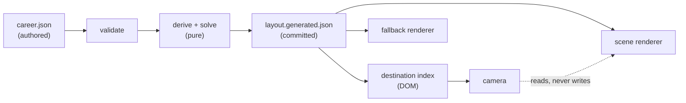
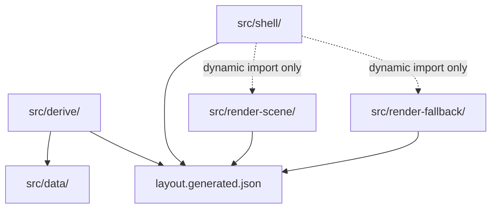
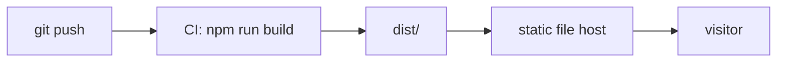

# Architecture Spine — Cosmos Portfolio

## Design Paradigm

**A build-time derivation pipeline feeding two read-only renderers.**

All data-to-visual reasoning happens once, at build time, in a pure pipeline: authored JSON → validated → derived → solved → committed artifact. At runtime nothing derives, nothing solves, and nothing computes a visual property; two independent renderers read the finished artifact and draw it.

The paradigm converts the product's three hardest constraints into structural properties rather than ongoing discipline: First Paint (NFR-1) is fast because the browser receives geometry rather than a physics problem; the opening frame (FR-24) is reproducible because the layout is committed rather than re-derived per load; and the two renderers cannot disagree (FR-22 content parity) because neither one interprets the source data.

Dataflow is unidirectional and acyclic at every layer.



| Paradigm stage | Namespace |
| --- | --- |
| Source of truth | `src/data/` |
| Pipeline (validate, derive, solve) | `src/derive/` |
| Renderers | `src/render-scene/`, `src/render-fallback/` |
| Entry, routing, state, index | `src/shell/` |

## Invariants & Rules

### AD-1 — Force settling runs at build time [ADOPTED]

- **Binds:** FR-2, NFR-1, FR-21, FR-24, NFR-5
- **Prevents:** A solver gating First Paint; an opening frame that differs on every load, making FR-24's composed frame and its matching link preview impossible; a Colophon that can only describe the layout rule rather than exhibit its output.
- **Rule:** The force simulation runs during the build and writes settled positions into a committed layout artifact. The runtime scene never solves. Re-solving is a deliberate, explicit act: `solve` is a **separate npm script that `build` never invokes**, and `build` fails if the committed artifact is missing or fails AD-14's schema. "Deliberate" is thereby a property of the scripts, not of the author's memory.

### AD-2 — The solve is deterministic

- **Binds:** FR-2, FR-24, AD-1
- **Prevents:** A committed artifact that churns on every build, producing meaningless diffs and silently breaking FR-24's reproducible opening frame.
- **Rule:** Identical input JSON must produce byte-identical layout output. Seed all randomness explicitly (`randomSource`), fix the iteration count rather than settling on an energy threshold, and never rely on object-key or float-accumulation ordering. A determinism regression test — solve twice, assert byte-identical — is part of the test suite, and **each solve must construct a fresh generator**: d3's default LCG is module-level state with a hardcoded seed that does not reset between runs, so a test reusing it would pass while proving nothing.

### AD-3 — Single derivation point

- **Binds:** FR-3, FR-5, FR-9, FR-18, FR-22, all renderers
- **Prevents:** The scene and the Fallback each interpreting the source data and disagreeing. Classification by absence (FR-5) makes this acute: `notable != null` and `notable !== ""` differ on an empty string, so one renderer would show a Deep Project and the other a Shallow one — unnoticed, because nobody views both surfaces at once.
- **Rule:** Every data-to-visual derivation — `isDeep`, mass, luminance band, dwell tempo, mote tier, shot framing — is computed once in `src/derive/` and resolved in the emitted artifact. No renderer contains a classification test, a mapping-rule computation, or any conditional on a raw content field. **No module outside `src/derive/` may import from `src/data/`** — not the renderers, not `shell/`, not `tokens/`, and not `colophon/` (which receives the raw file as emitted data, per AD-17, rather than importing it). There is exactly one read path to the source of truth.

### AD-4 — The DOM index is the source of truth for destinations

- **Binds:** FR-19, FR-22, EXPERIENCE.md §11, §11.1 P1–P4
- **Prevents:** Focusable elements sliding under the user during continuous camera motion, and off-screen Bodies having no valid focus position — the failure that makes "the camera is presentational, the index is the interface" aspirational rather than true.
- **Rule:** A persistent DOM navigation lists every destination, generated from the layout artifact. It never reads render state, never re-projects, never moves with the camera. The canvas is `aria-hidden`. Focus lives in the DOM; **the camera reacts to DOM focus, never the reverse.** Enforceably: no module outside `render-scene/` may import camera state, and no state field is written by the camera. Pointer raycasting (AD-15) is the one accepted read of scene geometry, and it resolves to an emitted destination ID rather than to a camera-dependent position. *[amended 2026-10-15 by ruling Q2 (story 4.1): the DOM index renders from the mount chunk, the one dynamic import after the thin entry, and still before any renderer chunk is requested; it is no longer on the entry chunk itself.]*

### AD-4a — The Rail is Client-granular; Projects are never Rail stops [ADOPTED]

- **Binds:** FR-16, FR-17, FR-17a, FR-18, AD-9, `derive/shots.ts`, `derive/dwell.ts`
- **Prevents:** The single largest divergence available to anyone building from this spine — encoding a Project-granular journey. The PRD's UJ-2 describes the camera bringing a visitor *to a Deep Project* and dwelling there; EXPERIENCE.md §9.2 ratifies that this is **no longer how it works** and marks it "STRUCTURAL DEVIATION FROM THE PRD — read this before building." A unit built from the PRD alone will produce ~15–16 Rail stops, per-Project Dwell, and a per-Project default Shot; a unit built from the UX will produce ~5–6. The two are incompatible at the camera, the index order, and the pacing model simultaneously, and neither surfaces until the camera exists.
- **Rule:** The Rail has one stop per **Client** (~5–6), never per Project. A Client stop frames that Client's entire system so every one of its Projects is on screen and selectable at once. **Dwell derives at Client granularity** (from the count of Deep Projects in that system), never per Project. The **default Shot template operates on Clients** and must frame the Client's full system including its widest-orbit Project — this is how FR-17a's "adding a Project produces a journey that visits it" is satisfied, by framing rather than by a new Shot. ~~`railPosition` in AD-9 indexes Clients.~~ *[superseded 2026-10-14 by ruling R1 (story 3.19): the field is dropped, with `selectClient`; `scrollProgress` alone says where the Rail is, and an integer `k` is the `k`-th Client stop. The rule that the Rail's stops are Clients stands.]* Projects are reached only by deliberate selection (AD-9 Focus), never by the Rail arriving at one.

### AD-5 — Destinations are addressed by stable entity ID

- **Binds:** AD-4, FR-17, FR-19
- **Prevents:** The two input paths — DOM focus and pointer raycast — resolving to different things; and Shot definitions decaying into position references, which FR-17 explicitly prohibits.
- **Rule:** Every destination reference — index entry, Shot subject, raycast hit, focus target, URL fragment — names an entity ID. Never a screen position, a render-order index, or an array offset.

### AD-6 — Routing decides before the 3D bundle is fetched

- **Binds:** FR-22, NFR-1, UJ-3
- **Prevents:** Shipping ~1MB of React, R3F, and Three to a mobile visitor who will only ever see a flat star chart — technically satisfying FR-22 while wrecking the Fallback's performance on precisely the devices UJ-3 depends on.
- **Rule:** Capability detection runs in the entry module as plain JavaScript, before any dynamic import resolves. Detection is **not** a React component and must not transitively load the scene. The entry chooses one chunk and loads only that.

### AD-7 — Three lazy chunks, one thin entry

- **Binds:** AD-1, AD-6, NFR-1, FR-21
- **Prevents:** The solver landing in the First Paint bundle and defeating AD-1; the scene loading for Fallback visitors; the Colophon's demonstration cost being paid by every visitor.
- **Rule:** `src/shell/entry` contains no React and no Three. **Four** chunks load dynamically and independently: `render-scene`, `render-fallback`, `colophon` (AD-17), and `solver` (the Colophon's live re-run only). **Nothing on the critical entry path may statically import the scene, the solver, or the raw career JSON.** This is a property of *bundler output*, not of source intent — a stray re-export can hoist a chunk into the entry silently. The build therefore asserts it: a CI check fails if the entry chunk exceeds its size budget or if its module graph reaches Three, the solver, or `src/data/`.

### AD-8 — Capability routes; performance offers

- **Binds:** FR-22, NFR-2a, NFR-3
- **Prevents:** An irreversible guess about a machine made before evidence exists, and a performance probe spending the one budget NFR-1 protects.
- **Rule:** `detect()` tests WebGL2 context creation only — no performance probe in the First Paint path. Mobile always routes to the Fallback, where **mobile means a coarse primary pointer, never viewport width**: EXPERIENCE.md §10 ratifies that window size is not a capability signal, so a narrow desktop window keeps the scene with a narrower panel. If the running scene then fails the NFR-2a floor, the Fallback is **offered** through the existing persistent one-click affordance, never forced. Reduced-motion is an independent axis: a `prefers-reduced-motion` visitor on a capable machine keeps the scene with adapted motion, and is never rerouted.

### AD-9 — One state machine owns navigation

- **Binds:** FR-12a, FR-16, FR-19, EXPERIENCE.md §5.1, §7.1, §7.1a
- **Prevents:** The camera and the DOM index disagreeing about what is focused; scroll's two meanings being resolved differently in two places; Escape releasing two layers at once.
- **Rule:** A single store holds ~~`{ mode: rail | freeflight, focusedProjectId: ProjectId | null, railPosition: ClientId }` — `railPosition` indexes **Clients**, per AD-4a~~ *[superseded 2026-10-14 by ruling R1 (story 3.19): `railPosition` and `selectClient` are dropped. `scrollProgress` already says where the Rail is — an integer `k` is the `k`-th Client stop — and a discrete twin with no writer invites the two-writer fight AD-16 forbids. Free flight keeps `scrollProgress`, so the Rail is re-entered where it was left.]*. Camera and index are both subscribers; neither owns state nor mutates it directly. All transitions are named events. Focus is exclusive — at most one `focusedProjectId`. Escape releases exactly one layer, innermost first, per EXPERIENCE.md §7.1a.

### AD-10 — Scroll meaning is resolved by mode alone

- **Binds:** FR-12a, AD-9, UJ-2
- **Prevents:** The bug that makes UJ-2 unbuildable — reading 150 words of prose moving the camera off the thing being read.
- **Rule:** Scroll's two meanings are selected **solely** by reading the state machine's mode, never by event-target inspection or DOM hit testing. While `focusedProjectId` is non-null, scroll belongs to the panel and the camera subscribes to nothing.

### AD-11 — Schema validation is a hard build gate

- **Binds:** FR-5, FR-7, UJ-4, NFR-5
- **Prevents:** The most dangerous failure this data model invites: because entities are typed by field *absence*, a misspelled field name silently changes an entity's type rather than raising an error. `notabel` instead of `notable` turns a Deep Project Shallow, with no error anywhere and no symptom until a reader fails to find the entry worth reading.
- **Rule:** `career.json` is validated against an explicit schema before derivation, and the build **fails** on violation. Validation must **reject unknown fields**, not merely check known ones. This is what makes UJ-4's "add an entry in five years" actually safe.

### AD-12 — Design tokens are generated from one source

- **Binds:** FR-20, DESIGN.md
- **Prevents:** The scene and the DOM surfaces drifting apart on colour, type, and stroke — invisible in code review, glaring on screen.
- **Rule:** DESIGN.md's frontmatter is the token source of truth. It is transformed once into CSS custom properties (DOM surfaces) and a typed JS object (scene materials). Both are generated from that single source; **neither is hand-transcribed**, and no colour or type value is written literally in a component.

### AD-13 — Two files, one authored

- **Binds:** FR-1, FR-21, NFR-5, UJ-4
- **Prevents:** A future maintainer editing the generated artifact, and the Colophon exhibiting an input file while claiming to exhibit a model.
- **Rule:** `career.json` is authored and is the sole source of truth. `layout.generated.json` is emitted, committed, and never hand-edited — it carries a generated-file banner. The Colophon renders **both, with the mapping rules between them**, so the transformation itself is what a visitor inspects.

### AD-14 — The layout artifact has a declared, versioned schema

- **Binds:** AD-1, AD-3, AD-13, both renderers, `colophon/`, `shell/`
- **Prevents:** The highest-leverage divergence in the system. `layout.generated.json` is the contract every consumer reads, and an undeclared contract is no contract: a scene unit would reasonably emit a flat Body array carrying 3D positions, while a Fallback unit — whose ratified projection is **time-as-axis**, not a projection of the solve — would reasonably emit a Client-nested tree carrying a time scalar. Both obey every other AD and consume two different documents that happen to share a filename.
- **Rule:** The artifact's shape is declared as an explicit, versioned schema in `src/derive/`, and the build fails if the emitted artifact does not validate against it. It carries **every surface's needs in one document**: entity IDs and kinds; solved 3D positions (scene); the time-axis scalar (Fallback); all derived visual properties (`isDeep`, mass, `luminanceBand`, mote tier); Dwell tempo at Client granularity; Shot framing; and the full content payload every surface renders, since FR-22 makes content parity absolute. A consumer needing a value the schema lacks is a change to the schema and the derivation, never a local computation.

### AD-15 — One emitted destination set

- **Binds:** AD-4, AD-5, FR-19, EXPERIENCE.md §11
- **Prevents:** Two owners of the destination set. AD-4 (DOM index) and AD-5 (raycast) both address by entity ID and can still diverge: a Moon or a Client Star may raycast to an entity the index has no entry for, and an off-screen Body exists in one path but not the other — the exact failure AD-4's *Prevents* clause names, reintroduced through the back door.
- **Rule:** The derivation emits **one `destinations` list**; the DOM index and the raycast target set are both built from it and from nothing else. Their cardinality is asserted equal at the build gate. An entity that is not in `destinations` is not reachable by any input path, and one that is must be reachable by all of them.

### AD-16 — One writer per state field

- **Binds:** AD-9, AD-4a, EXPERIENCE.md §5.1, §7.1a
- **Prevents:** Two units writing the same field by different mechanisms. A Rail unit would drive `railPosition` continuously from damped scroll; a keyboard-index unit would set it discretely on activation — leaving `aria-current` disagreeing with the camera about where the visitor is. *[superseded 2026-10-14 by ruling R1 (story 3.19): the field named here is dropped; scroll progress is the one record of where the Rail is, so there is no discrete field left for a second writer to contest.]* Separately, EXPERIENCE.md §7.1a's Escape table must know *where Focus was entered from*, which a three-field store cannot represent.
- **Rule:** Every state field has exactly one writer. The store carries `focusOrigin` (`rail | freeflight`) explicitly, stored at Focus entry rather than inferred at release, so Escape returns to the layer it came from. ~~Continuous scroll progress and the discrete current Client are **separate fields**: the camera reads progress, the index reads the discrete Client, and neither writes the other's.~~ *[superseded 2026-10-14 by ruling R1 (story 3.19): there is no discrete current-Client field; the camera reads scroll progress and writes nothing.]*

### AD-17 — The Colophon is a fourth chunk and re-solves in isolation

- **Binds:** AD-2, AD-7, AD-13, FR-21
- **Prevents:** Two failures at once. First, a literal reading of AD-7's three-chunk list leaves `colophon/` unaccounted for while FR-21 requires it to render raw `career.json` — which would put the raw file in the entry bundle and defeat AD-7. Second, AD-2's determinism is a *same-environment* guarantee: a live browser re-solve may legitimately settle differently from the committed Node solve, so the one surface built to prove the site cannot rot would be caught demonstrating it rotting.
- **Rule:** `colophon/` is a **fourth lazy chunk**, loaded on navigation and never on the critical path. Both files it exhibits reach it as **emitted data** — the raw JSON is copied into the build output as an asset, never statically imported. Its live re-solve is presented as a **demonstration of the mechanism, not a reproduction of the shipped layout**, and the page says so; the committed artifact remains the only layout any renderer reads.

### AD-18 — Three addressable surfaces, one router

- **Binds:** FR-21, FR-22, AD-6, AD-7, EXPERIENCE.md §4.7
- **Prevents:** Three independently reachable surfaces (scene, Fallback, Colophon) with no owner for how a visitor moves between them or what the browser Back button does. EXPERIENCE.md §4.7 specifies a return contract — the scene resumes at the stop it was left at, not at First Paint — which is unbuildable if navigation is unowned.
- **Rule:** The three surfaces are the only addressable routes, resolved in `shell/` by AD-6's entry before any chunk loads. Route changes are real history entries, so Back works. Surface-level position (which Client stop the scene was left at) is preserved on departure and restored on return; **Focus is not a route** and does not create a history entry — it is scene state, released by Escape per AD-9, never by Back.



## Consistency Conventions

| Concern | Convention |
| --- | --- |
| Vocabulary | PRD §3 Glossary verbatim — Company, Client, Project, Skill, Body, Mote, Notable, Deep/Shallow Project, Weight, Focus, Condensation, Rail, Shot, Dwell, Schematic Identity, Colophon, Fallback, First Paint, The Forward. **Company** is load-bearing: FR-6 exists to keep it an attribute and never a Body. **Moon** and **Ring** are the two ratified Deep/Shallow channels added by DESIGN.md (`satellite` is superseded by `Moon`); the Fallback carries the signal by Ring alone. A synonym in code or copy is a discipline violation. |
| Entity IDs | Stable, derived from authored content, never positional. An ID must survive a re-solve and a re-order unchanged. |
| Naming | Derived properties are named for what they *are*, not their source: `isDeep`, not `hasNotable`; `luminanceBand`, not `recencyValue`. The mapping is AD-3's business; consumers read results. |
| Generated files | Carry a header banner naming the generator and forbidding hand-editing. Committed, and diffable on purpose. |
| State mutation | Only through the state machine's named events (AD-9), one writer per field (AD-16). No component mutates navigation state directly. |
| Boundary enforcement | AD-3's and AD-7's import bans are enforced by tooling, not honour — an ESLint import-boundary rule (or equivalent) fails the build on violation, and the AD-7 bundle assertion runs in CI. A rule the memlog itself predicts will "erode under pressure" is not left to discipline in a solo project promising a decade of health. |
| Scene state reads | Inside `useFrame`, read via `store.getState()` — never a reactive hook binding, which would re-render every frame. |
| Errors | Build-time errors fail loud and block the build (AD-11). Runtime has almost no error surface by construction — no backend, no fetch, no auth; the contact route is the one genuine exception. |
| Dates | ISO 8601 in authored data. All display formatting is derived, never authored. |
| Config | None. No environment variables, no secrets, no runtime configuration — a static site with no backend has nothing to configure. |

## Stack

Verified against the npm registry 2026-09-01. Pin exact versions; stay off the R3F v10 / drei v11 alpha line.

| Name | Version |
| --- | --- |
| TypeScript | 7.0.x |
| Vite | 8.2.x |
| React | 19.x |
| @react-three/fiber | 9.7.x (stable — **not** v10 alpha) |
| three | 0.185.x |
| @react-three/drei | 10.7.x (stable — **not** v11 alpha) |
| d3-force-3d | 3.0.6 |
| zustand | 5.0.x |
| Node (build only) | 24 LTS |
| happy-dom (test only) | 20.14.6 — devDependency; the render harness's client path (`scripts/render.ts`) alone, never `src/` or a shipped chunk (ruling (a), 2026-10-28, Epic 5 retro item 42) — advisory GHSA-834v-8h66-3h79 accepted as test-only (2026-10-28); move to 21.x owed, deferred-work.md |

**Pairing is load-bearing, not incidental.** drei 10 is the only stable major whose peers accept R3F 9 + React 19 (`react: ^19`, `@react-three/fiber: ^9.0.0`); drei 9 declares `react: ^18` / `@react-three/fiber: ^8` and will not install against this stack. `three >= 0.159` is drei 10's binding constraint. Node 22 entered maintenance in October 2025 and is EOL April 2027 — inside the window UJ-4 promises a cheap rebuild, so the build starts on 24.

## Structural Seed

```text
cosmos-portfolio/
  src/
    data/                  # authored career.json + its schema. Imported ONLY by derive/.
      career.json
      schema.ts
    derive/                # pure: validate -> derive -> solve. No DOM, no React, no Three.
      artifact-schema.ts   #   the layout artifact contract (AD-14)
      rules.ts             #   three mapping rules + classification by absence
      dwell.ts             #   Client-granularity tempo (AD-4a)
      shots.ts             #   default Shot templates, Client-granular (AD-4a)
      destinations.ts      #   the one emitted destination set (AD-15)
      solve.ts             #   d3-force-3d, seeded and deterministic
      index.ts             #   pipeline entry, emits layout.generated.json
    shell/                 # entry, detection, routing, state, destination index
      entry.ts             #   NO React, NO Three. detect() + dynamic import.
      router.ts            #   three surfaces, real history entries (AD-18)
      state.ts             #   navigation state machine (AD-9, AD-16)
      index-nav.tsx        #   persistent DOM destination index (AD-4)
    render-scene/          # R3F. Reads the artifact only.
    render-fallback/       # DOM + semantic HTML. Reads the artifact only.
    colophon/              # raw + rules + derived; lazily loads solver for live re-run
    tokens/                # generated from DESIGN.md frontmatter (AD-12)
  generated/
    layout.generated.json  # committed build artifact (AD-1, AD-13)
  public/
    preview.png            # committed FR-24 og:image
```

### Deployment & environments



- **Build:** `validate → derive+solve (deliberate) → vite build → dist/`
- **Host:** any static file host (Cloudflare Pages, Netlify, GitHub Pages, S3). No Node process, no serverless function, no database, no environment variables, no secrets — at any milestone (NFR-6).
- **Environments:** production only. A personal portfolio has no reader for a staging tier.
- **Rollback:** redeploy a previous commit.

## Capability → Architecture Map

| Capability / Area | Lives in | Governed by |
| --- | --- | --- |
| FR-1 embedded JSON as sole truth | `data/` | AD-13, AD-11 |
| FR-2 force-solved layout | `derive/solve.ts` | AD-1, AD-2 |
| FR-3 three mapping rules | `derive/rules.ts` | AD-3 |
| FR-5 classification by absence | `derive/rules.ts` | AD-3, AD-11 |
| FR-9 Deep/Shallow signal | `derive/rules.ts` → both renderers | AD-3 |
| FR-12a Focus model | `shell/state.ts` | AD-9, AD-10, AD-16 |
| FR-13 condensation | `render-scene/` | AD-3 (tiers derived) |
| FR-16..FR-19 rails, dwell, free flight | `derive/shots.ts`, `derive/dwell.ts`, `shell/state.ts` | **AD-4a**, AD-5, AD-9, AD-15 |
| FR-20 schematic identity | `tokens/` | AD-12 |
| FR-21 Colophon | `colophon/` | AD-13, AD-17, AD-18 |
| FR-22 Fallback | `render-fallback/`, `shell/entry.ts` | AD-6, AD-8, AD-3, AD-14 |
| Shared layout contract | `derive/artifact-schema.ts` | AD-14 |
| Surface routing & history | `shell/router.ts` | AD-18 |
| FR-24 shareability | `public/preview.png` | AD-1 |
| a11y floor (EXPERIENCE.md §11) | `shell/index-nav.tsx` | AD-4, AD-5 |
| NFR-1 First Paint | `shell/entry.ts` | AD-1, AD-6, AD-7 |
| NFR-5 maintenance contract | whole pipeline | AD-1, AD-3, AD-11, AD-13 |

## Deferred

- **M3 realism pass (textures, lighting, post-FX).** DESIGN.md already names its three attachment points — Body fill, the Dust medium, the vignette. No architectural decision is needed until M2 ships; taking one now would be guessing.
- **M4 collapse ending.** PRD R-6 proposes a procedural in-engine implementation; unratified and post-launch. It reuses the existing force system, so AD-1's build-time boundary is the only thing it must respect.
- **Dwell, condensation, and dust-density numbers.** The PRD and UX both direct these to M1 greybox tuning, where they are cheapest. The architecture fixes *where* they are derived (AD-3), not their values.
- **Free-flight camera interpolation.** EXPERIENCE.md ratifies the destination model; the interpolation curve is a motion-design decision for M1, not a structural one.
- **Fallback visual layout.** Ratified in UX (time-as-axis, transposing on phone) and drafted as a mock. No architectural call remains beyond AD-3's shared derivation.
- **Analytics.** Permanently out — SM-1 is anecdotal by construction, and instrumenting it would contradict NFR-6 and serve the counter-metric SM-C1.
- **Testing beyond the pipeline.** Derivations are pure and unit-tested; determinism has a regression test; the Fallback's semantics are checkable. Scene correctness is perceptual and is tested by looking at it at M1, per the PRD's own plan.
- **Content authoring tooling.** Roughly nine entries remain (PRD §8.3). If authoring proves painful, tooling is an M3+ concern — AD-11's schema gate may well be sufficient alone.

## Open Questions

- **FR-24 preview drift.** The committed `preview.png` can silently diverge from the opening frame if the layout is re-solved without regenerating it. Headless WebGL at build time was rejected (native dependency, fragile across years — the exact rebuild UJ-4 promises is cheap). Proposed: a build-time warning when `layout.generated.json` is newer than `preview.png`. Cheap, no native dependencies, fails loud. **The warning is implemented (6.2):** `scripts/preview-drift.ts` runs in `npm run build` between the gate and `vite build`, compares git committer times (mtimes for uncommitted changes or without git), warns on stderr and always exits 0. **Its limit:** it fires on a full-history checkout (the machine the re-solve happens on) and is structurally silent on a shallow clone — CI's `actions/checkout` and most host builds — where both files' last commit is HEAD; it also watches the layout only, not the preview's other inputs (chrome strings, tokens, `scripts/preview.ts`). **Escalating it to a build failure is open, not assumed** — it stays a warning until that is ratified.
- **Host choice.** Cloudflare Pages and Netlify are equivalent for this purpose; the decision is preference, not architecture.
- **`weight` semantics in the solver.** FR-3 binds distance-from-Rail to `weight`, but whether that is a force parameter or a post-solve transform is unsettled. It affects AD-2's determinism surface and is cheapest to settle when `solve.ts` is first written.
